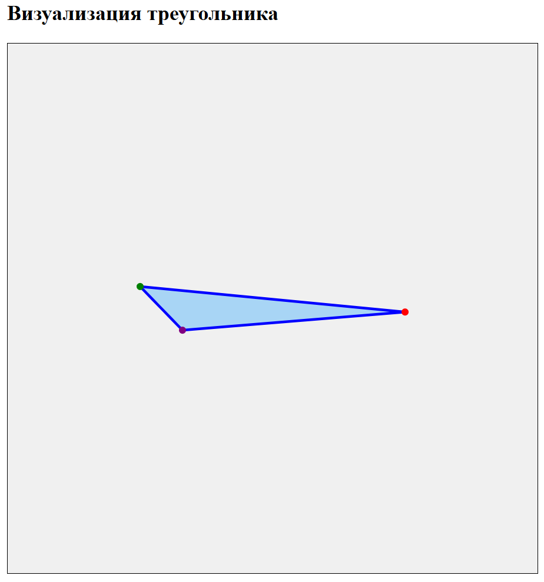

# Лабораторная работа №7: Наследование (Классы Polygon и Triangle)

**Студент:** Загребова С.В.  
**Дисциплина:** Программирование на языке C++

## 🎯 Цель работы
Получить практические навыки разработки объектно-ориентированных программ на языке C++ с использованием наследования, виртуальных функций и обработки исключительных ситуаций.

## 📋 Задание (Вариант 2)
Создать базовый класс `Polygon` (многоугольник) и производный класс `Triangle` (треугольник). 
Программа должна вычислять периметр, площадь, длины медиан и биссектрис, а также находить координаты точек пересечения медиан (центроид), биссектрис (инцентр) и высот (ортоцентр).

## 📂 Структура проекта
Код разделен на модули для удобства поддержки:
* `Point.h` — структура для хранения координат точки (x, y) и метод вычисления расстояния.
* `Polygon.h` — **базовый абстрактный класс**. Содержит чисто виртуальные функции `perimeter()`, `area()`, `draw()`.
* `Triangle.h` / `Triangle.cpp` — **производный класс**, наследуется от `Polygon`. Реализует специфические методы (поиск медиан, биссектрис, высот) и генерирует визуализацию.
* `main.cpp` — точка входа, консольный интерфейс для ввода координат и вывода результатов.

## 🖼️ Визуализация результата
Помимо расчетов, программа генерирует файл `triangle.html`, в котором с помощью SVG-графики рисуется треугольник по заданным координатам.



*(Примечание: файл `triangle.html` можно открыть в любом браузере, чтобы увидеть интерактивную картинку)*

## 🖥️ Пример работы программы
```text
==================================================
     НАСЛЕДОВАНИЕ: МНОГОУГОЛЬНИК И ТРЕУГОЛЬНИК
==================================================
Введите координаты вершины A (x y): 10.25 8.1
Введите координаты вершины B (x y): -10.01 10.05
Введите координаты вершины C (x y): -6.77 6.709

--- Результаты расчетов ---
Периметр: 42.0844
Площадь:  30.6853

Длины медиан: m_a = 18.6421, m_b = 12.0441, m_c = 7.28492
Длины биссектрис: l_a = 18.4987, l_b = 7.11023, l_c = 3.12314

Точка пересечения медиан (Центроид): (-2.17667, 8.28633)
Точка пересечения биссектрис (Инцентр): (-6.2025, 8.21852)
Точка пересечения высот (Ортоцентр): (0.922257, 17.4102)

Треугольник успешно построен! Откройте файл 'triangle.html' в браузере.
