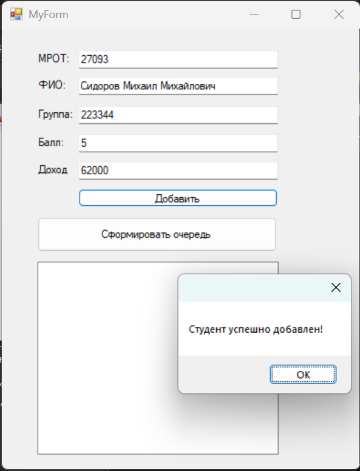
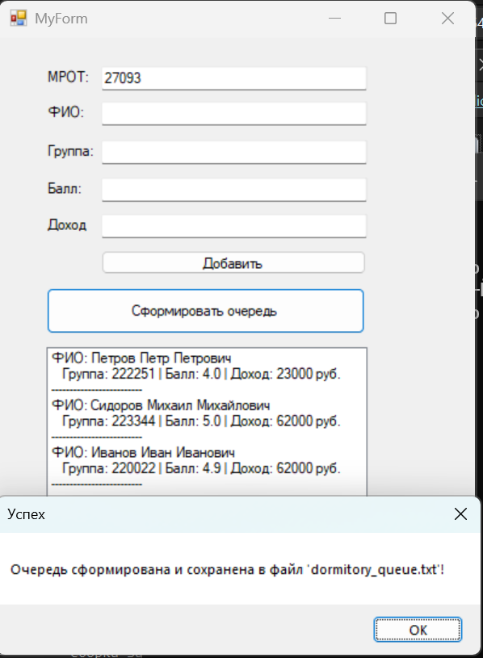

# Лабораторная работа №8: Создание графического интерфейса

**Студент:** Загребова С.В.  
**Дисциплина:** Программирование на языке C++

## 🎯 Цель работы
Изучить методику создания множественного наследования, использование абстрактного базового класса, файловый ввод-вывод и использование функций обработки исключительных ситуаций. Получить навыки создания графического интерфейса программ (Windows Forms).

## 📋 Задание (Вариант 2)
Создать программу для формирования списка студентов на получение места в общежитии. Список включает ФИО, группу, средний балл и доход на члена семьи. 
Общежитие в первую очередь предоставляется тем, у кого доход на члена семьи меньше двух минимальных зарплат (МРОТ), затем остальным в порядке уменьшения среднего балла.

## 🖥️ Визуализация работы программы

<p align="center">
  
  
</p>

## 📂 Структура проекта
* `Logic.h` — содержит бизнес-логику и архитектуру классов:
  * `Human` — абстрактный базовый класс (ФИО).
  * `DormitoryData` — базовый класс для данных общежития (балл, доход).
  * `Student` — производный класс (множественное наследование от `Human` и `DormitoryData`).
  * `Run()` — friend-функция для сортировки и сохранения очереди в файл.
* `MyForm.h` / `MyForm.cpp` — файлы графического интерфейса (обработчики нажатий кнопок, вывод списка).
* `MyForm.resx` — файл ресурсов формы.

## 💾 Работа с файлами
Результат работы программы сохраняется в файл `dormitory_queue.txt`.

Пример содержимого файла:
```text
=== ОЧЕРЕДЬ НА ОБЩЕЖИТИЕ ===
Петров Петр Петрович | Группа: 222251 | Балл: 4 | Доход: 23000
Сидоров Михаил Михайлович | Группа: 223344 | Балл: 5 | Доход: 62000
Иванов Иван Иванович | Группа: 220022 | Балл: 4.9 | Доход: 62000
